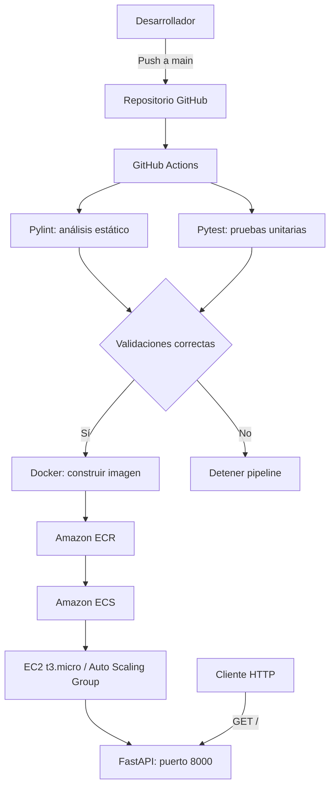
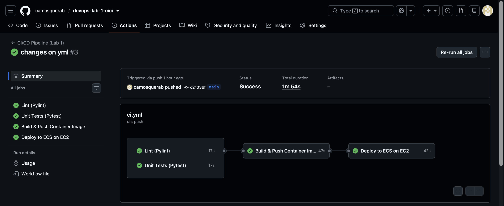
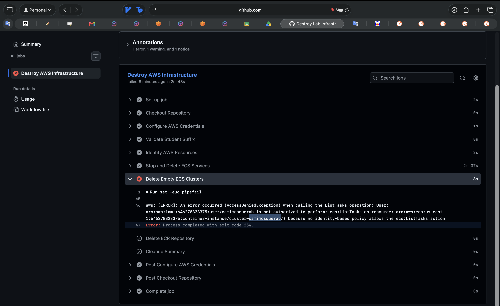
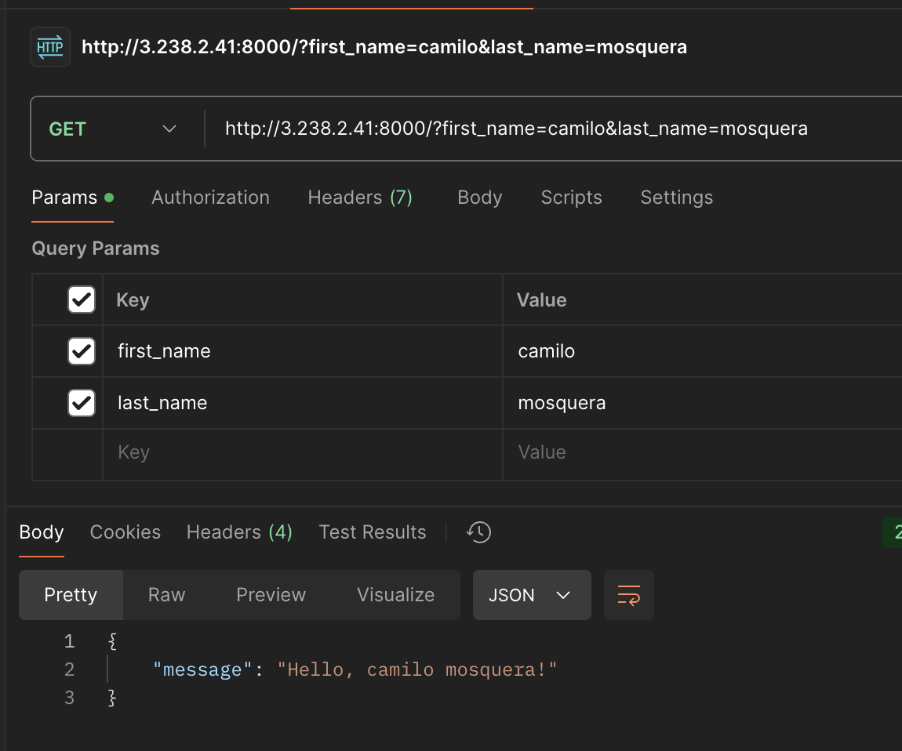

# Lab 01: CI/CD con GitHub Actions y Amazon ECS

## 1. Objetivo y arquitectura

El objetivo del laboratorio es **automatizar la integración y el despliegue continuo (CI/CD)** de una aplicación desarrollada en **Python con FastAPI**. La aplicación se empaqueta en un contenedor Docker y se despliega en **Amazon ECS**, utilizando instancias **EC2 t3.micro** administradas por un **Auto Scaling Group**.

### 1.1. Componentes de la solución

| Componente | Función en el laboratorio |
|---|---|
| GitHub | Almacena el código fuente y los archivos de configuración. |
| GitHub Actions | Ejecuta los workflows de validación, publicación, despliegue y limpieza. |
| Pylint | Realiza el análisis estático del código Python. |
| Pytest | Ejecuta las pruebas unitarias de la aplicación. |
| Poetry | Administra las dependencias del proyecto. |
| Docker | Construye una imagen con la aplicación y sus dependencias. |
| Amazon ECR | Almacena las imágenes Docker publicadas por el pipeline. |
| Amazon ECS | Administra el servicio y las tareas que ejecutan el contenedor. |
| EC2 + Auto Scaling Group | Proporcionan la capacidad de cómputo para ejecutar las tareas ECS. |

### 1.2. Diagrama de arquitectura



### 1.3. Conceptos de CI/CD aplicados

**Integración continua (CI):** cada cambio enviado al repositorio se somete a controles automáticos. Pylint revisa la calidad del código y Pytest comprueba el funcionamiento de las unidades evaluadas. Si alguna etapa falla, se impide continuar con la publicación y el despliegue.

**Despliegue continuo (CD):** después de superar las validaciones, GitHub Actions construye la imagen Docker, la publica en ECR y ejecuta el script que despliega la nueva versión en ECS. La imagen se etiqueta con el identificador del commit (`github.sha`) y con `latest`, lo que facilita relacionar las versiones desplegadas con el código fuente.

**Contenerización:** Docker permite ejecutar FastAPI junto con sus dependencias en un entorno reproducible. ECS organiza su ejecución y EC2 proporciona la infraestructura sobre la cual funciona el contenedor.

### 1.4. Identificación del entorno AWS

| Parámetro | Valor |
|---|---|
| Usuario IAM / `STUDENT_SUFFIX` | `camimosquerab` |
| Región | `us-east-1` |
| Cuenta AWS | `646278323375` |
| Repositorio ECR | `greeting-camimosquerab` |
| Clúster ECS | `cluster-camimosquerab` |
| Servicio ECS | `service-greeting-camimosquerab` |
| Tipo de instancia del laboratorio | `t3.micro` |
| Puerto de FastAPI | `8000` |

Las credenciales y contraseñas **no se incluyen** en este documento; las claves de acceso se configuran como secretos del repositorio.

## 2. Pipeline automático de integración y despliegue

El workflow de CI/CD se define en `.github/workflows/ci-cd.yml`. Se ejecuta al hacer `push` a `main`, valida cambios propuestos mediante `pull_request` y también admite ejecución manual con `workflow_dispatch`.

| Etapa | Acción | Resultado esperado |
|---|---|---|
| **1. Lint** | `poetry run pylint src` | Código analizado sin errores que bloqueen el trabajo. |
| **2. Test** | `PYTHONPATH=src poetry run pytest tests -vv` | Pruebas unitarias superadas. |
| **3. Build & Push** | Construcción Docker y publicación en ECR. | Imagen disponible en `greeting-camimosquerab`. |
| **4. Deploy** | Ejecución de `scripts/deploy.sh`. | Servicio ECS actualizado con la imagen publicada. |

Las etapas **Lint** y **Test** pueden ejecutarse en paralelo. **Build & Push** depende de ambas, mientras que **Deploy** depende de que la publicación termine correctamente. En las solicitudes de incorporación de cambios (*pull requests*) se realizan las validaciones sin desplegar la aplicación.

### 2.1. Evidencia visual: ejecución exitosa

La siguiente captura debe mostrar los cuatro trabajos completados correctamente en GitHub Actions.



**Verificación:** Lint, Test, Build & Push y Deploy en estado exitoso. La evidencia se incorpora una vez confirmada la ejecución.

## 3. Pipeline manual de eliminación de infraestructura

Para evitar mantener recursos innecesarios después de la práctica, se contempla un workflow de limpieza en `.github/workflows/destroy.yml`, activado exclusivamente mediante **`workflow_dispatch`**. Su ejecución debe identificar los recursos asociados al sufijo `camimosquerab` y requerir confirmación antes de realizar eliminaciones.

De acuerdo con el alcance del taller, el proceso de *teardown* debe retirar:

1. Servicio ECS y sus tareas.
2. Auto Scaling Group e instancia EC2 del laboratorio.
3. Clúster ECS.
4. Launch Template y Security Group asociados.
5. Repositorio ECR y sus imágenes.

La eliminación debe realizarse en un orden que respete las dependencias entre recursos. También requiere permisos IAM suficientes; por ejemplo, la consulta de tareas ECS puede fallar si falta `ecs:ListTasks`.

**Nota:** el alcance anterior corresponde al objetivo del taller. Para afirmar que todos los recursos fueron eliminados, debe verificarse que `destroy.yml` invoque el script de limpieza completo y que la ejecución haya finalizado sin errores.

### 3.1. Evidencia visual: ejecución manual exitosa

La captura debe mostrar la ejecución manual del workflow y su resultado exitoso.



**Verificación:** revisar el registro del workflow y comprobar en AWS que no permanezcan los recursos creados por el laboratorio.

## 4. Validación HTTP de la aplicación

Después del despliegue se consultó el endpoint principal de FastAPI utilizando la IP pública de la instancia EC2 y el puerto `8000`. La petición envía el nombre y apellido como parámetros de consulta (*query parameters*).

**Solicitud realizada:**

```http
GET http://3.238.2.41:8000/?first_name=camilo&last_name=mosquera
```

La misma solicitud puede ejecutarse desde una terminal:

```bash
curl "http://3.238.2.41:8000/?first_name=camilo&last_name=mosquera"
```

**Respuesta esperada según el taller:**

```json
{
  "message": "Hello, camilo mosquera!"
}
```

La respuesta permite comprobar que el endpoint recibe `first_name` y `last_name` y genera un saludo personalizado. Una respuesta correcta confirma que la aplicación es accesible desde el cliente en el momento de la prueba; por sí sola no verifica todos los componentes internos de AWS.

### 4.1. Evidencia visual: petición HTTP



| Dato | Valor |
|---|---|
| Método | `GET` |
| IP pública utilizada | `3.238.2.41` |
| Puerto | `8000` |
| Endpoint | `/` |
| Parámetros | `first_name=camilo`, `last_name=mosquera` |
| Respuesta esperada | `Hello, camilo mosquera!` |

La captura debe mostrar la URL consultada y la respuesta real obtenida mediante navegador, Postman o cURL.

## 5. Propuestas de mejora

| Mejora | Propuesta | Beneficio |
|---|---|---|
| **Seguridad de imágenes** | Analizar imágenes Docker con Trivy antes de publicarlas. | Detectar vulnerabilidades conocidas. |
| **Autenticación AWS** | Sustituir claves permanentes por GitHub OIDC y roles IAM de permisos mínimos. | Reducir riesgos asociados a credenciales. |
| **Validación posterior al despliegue** | Consultar automáticamente `/health` y comprobar la respuesta HTTP. | Detectar despliegues que terminan sin dejar la aplicación operativa. |
| **Monitoreo** | Centralizar registros y métricas en Amazon CloudWatch. | Identificar errores y problemas de disponibilidad. |
| **Optimización** | Habilitar caché de Poetry y de capas Docker. | Reducir el tiempo de ejecución del pipeline. |
| **Infraestructura como código** | Gestionar recursos con Terraform. | Hacer más reproducible la creación y limpieza del entorno. |

## 6. Conclusión

El laboratorio integra prácticas fundamentales de DevOps: validación automática del código, pruebas unitarias, contenerización, publicación de imágenes y despliegue en la nube. GitHub Actions coordina las cuatro etapas, mientras que ECR, ECS y EC2 permiten almacenar y ejecutar la aplicación FastAPI.

La petición HTTP sirve como prueba funcional del servicio desplegado. Por otra parte, el workflow manual de limpieza permite abordar el ciclo de vida de la infraestructura y el control de recursos. Las mejoras propuestas apuntan a fortalecer la seguridad, observabilidad y confiabilidad del proceso.

---

### Organización de las evidencias

Las capturas deben guardarse con estos nombres para que GitHub las muestre correctamente:

```text
docs/
├── lab1.md
└── images/
    ├── pipeline-success.png
    ├── destroy-success.png
    └── http-success.png
```
